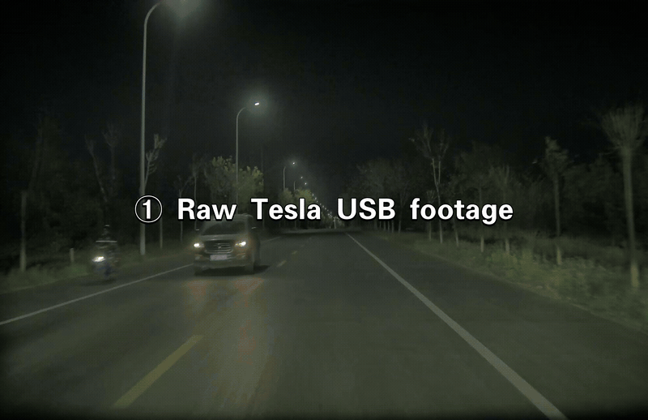
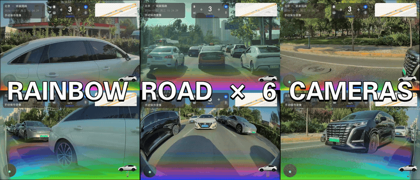
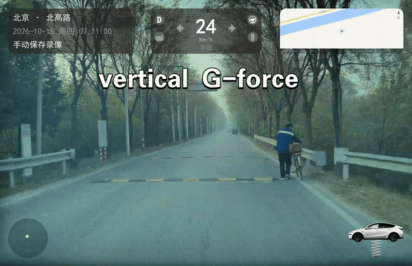
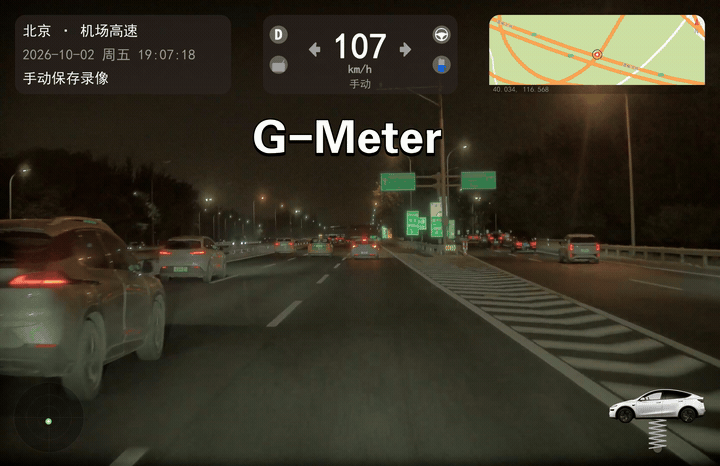
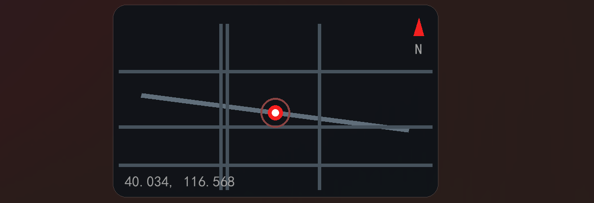
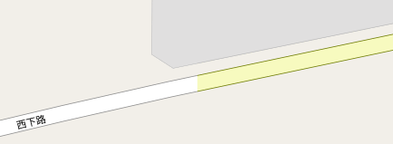
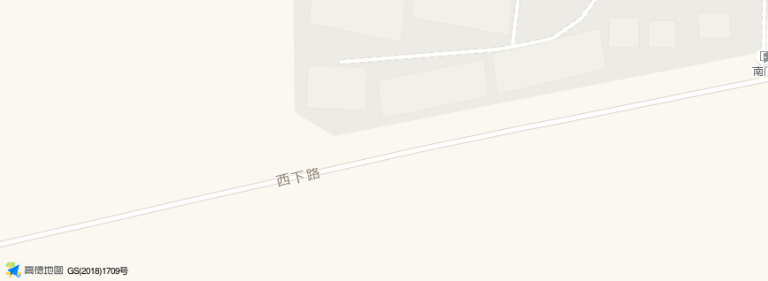
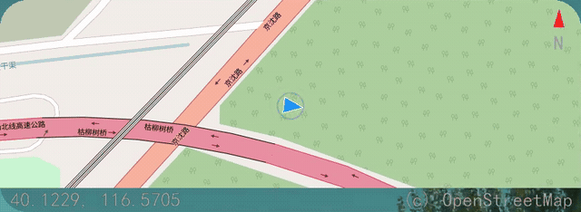

# 上帝之手 Hand of God

**把特斯拉 U 盘里的行车视频，还原成车机屏幕上的样子。**

Tesla dashcam telemetry overlay — restore speed, pedals, blinkers, autopilot status, G-force and maps onto your USB clips.

---

## 这是什么

特斯拉 U 盘导出的原始行车视频，只有纯画面，车机屏幕上的时速、刹车、转向灯等信息全都没有。
其实这些数据一直藏在每一段视频里（SEI 帧数据）。本工具把它们重新提取出来，叠加回视频：

- **时速表**：支持 km/h / mph
- **油门 / 刹车踏板**：实时显示踩下的力度，刹车时小车尾灯同步点亮
- **转向灯**：按实车节奏（400ms 亮 / 300ms 灭）闪烁
- **辅助驾驶状态**：AP 主动巡航 / 辅助转向状态还原（可用来确认自己到底有没有开过 AP）
- **G 值小车**：加速推背、急刹点头、过弯侧倾、过减速带的颠簸，小车跟你一起晃
- **彩虹之路**：辅助转向时的彩虹道路特效，并且**随车速实时变化快慢**（原装车机是匀速的）
- **三层地图**：
  1. 无网络 → 内置示意地图兜底（任何时候都能出片）
  2. 有网络 → 自动使用 OpenStreetMap（OSM）开源地图，定位精准
  3. 配置高德 Key → 高德地图，样式更好看（需免费申请）
  - 素材含**逐帧 GPS**（海外车型可连续定位）时，地图会**随车移动**并用箭头指示行驶方向；国内素材只有单个坐标点，自动降级为静态地图

成片和车机屏幕一模一样，而且多了不少车机上都不显示的隐藏信息。

---

## 效果展示



### 彩虹之路，六路同框

在**全部 6 路摄像头**（前 / 后 / 左B柱 / 右B柱 / 左翼子板 / 右翼子板）同步还原彩虹之路，且彩虹的流动速度随真实车速实时变化——原厂反而是匀速的。



### 过减速带？弹簧车陪你一起颠

右下角的小车根据真实的 **Z 轴垂直 G 值**（vertical G-force）实时弹跳：压上减速带时悬挂压缩、随后回弹。下图这段实测峰峰值达到 **0.8g**，前轮、后轮两次冲击清晰可见。



### 一个球看清你的每脚油门、刹车和方向

左下角的 **G 值球**（G-Meter）实时显示横向 + 纵向的合成加速度：加速时球向后仰（推背），刹车时向前冲（点头），过弯时甩向弯外。



### 三层地图：没网也能用，有网自动升级

右下角地图按网络条件自动切换，任何环境都能出片。若素材带逐帧 GPS（海外车型），地图还会跟着车一起移动：

<table>
<tr>
<td width="33%"><br><b>① 内置示意地图</b><br>无网络时的兜底方案：根据 GPS 坐标绘制指北针、经纬坐标和简化路网，保证永远有图</td>
<td width="33%"><br><b>② OpenStreetMap</b><br>有网络自动启用：开源街景地图，真实道路和路名，定位精准，无需任何配置</td>
<td width="34%"><br><b>③ 高德地图</b><br>配置免费 Key 后启用：样式更美观、国内道路信息最新（图片保留高德版权标识）</td>
</tr>
</table>

### 地图会跟着你跑

海外车型能连续采集定位，本工具会读取**每一帧的 GPS 和车头朝向**：先把整条路线预取成一张大画布，再逐帧裁出以车为中心的窗口，于是地图随车滚动，蓝色箭头实时指示行驶方向。

下图用一段测试轨迹演示（箭头随路线缓慢转向）：



**没 GPS 时自动降级**：国内特斯拉的 SEI 里经纬度全为 0，工具检测到后会**自动退回上面的静态地图**（用 `event.json` 里的单个坐标点定位），无需任何手动开关，成片照样完整。

---

## 小白安装指南（从零开始，约 10 分钟）

本工具运行在电脑上，需要装三样东西：**Python、ffmpeg、Pillow**。下面每一步都可以照抄。

### 第 1 步：安装 Python

1. 打开 <https://www.python.org/downloads/>，点击黄色大按钮下载最新版
2. 双击安装包，**第一个界面最下方一定要勾选 `Add python.exe to PATH`**（非常重要！漏勾后面全部报错）
3. 点 `Install Now` 一路装完
4. 验证：按 `Win + R`，输入 `powershell` 回车，在弹出的蓝窗口里输入：

   ```powershell
   python --version
   ```

   能看到类似 `Python 3.12.x` 就成功了。

### 第 2 步：安装 ffmpeg（视频合成必需）

在 PowerShell 窗口里直接输入这一行并回车：

```powershell
winget install Gyan.FFmpeg
```

装完后**关闭并重新打开** PowerShell，输入 `ffmpeg -version`，出现一堆版本号即成功。

> 如果提示找不到 winget（Win10 老版本），请更新系统或改用：Microsoft Store 搜索安装「应用安装程序」。

### 第 3 步：安装 Pillow（图像处理库）

在 PowerShell 里输入：

```powershell
pip install pillow
```

### 第 4 步（可选）：配置高德地图 Key

不配也能用，只是地图用 OpenStreetMap（精准、样式朴素）。想要高德地图的好看样式：

1. 打开 <https://lbs.amap.com> 注册登录
2. 控制台 → 应用管理 → 我的应用 → 创建新应用 → 添加 Key，**服务平台选「Web 服务」**
3. 复制 Key，粘贴进本项目文件夹里的 `amap_key.example.txt`
4. 把该文件重命名为 `amap_key.txt`（去掉 `.example`）

个人开发者每日免费 5000 次，本工具每次处理只调用几次，完全够用。

---

## 使用方法

### 方法一：拖拽（推荐，不用敲任何命令）

1. 把 U 盘插到电脑上，找到保存的事件文件夹（里面有 `event.json` 和各机位 mp4）
2. 用鼠标把**整个文件夹**拖到本工具文件夹里的 **`拖入视频或文件夹到这里.bat`** 图标上
3. 松开鼠标，自动开始处理；完成后成片 `*_with_overlay.mp4` 会出现在原视频旁边

单个视频文件拖上去也可以。

### 方法二：命令行

```powershell
# 处理整个事件文件夹（成片生成回该文件夹）
python tesla_dashcam_processor.py "D:\TeslaCam\SavedClips\2026-10-07_15-26-06"

# 处理单个视频（自动在旁边生成 xxx_with_overlay.mp4）
python tesla_dashcam_processor.py "D:\xxx\2026-10-07_11-04-55-front.mp4"

# 指定输出位置
python tesla_dashcam_processor.py "输入.mp4" "输出.mp4"

# 英里制（MPH）
python tesla_dashcam_processor.py "输入文件夹" --imperial

# 只提取行车数据 CSV，不渲染视频
python tesla_dashcam_processor.py "输入.mp4" --csv-only

# 清空本地地图瓦片缓存
python tesla_dashcam_processor.py --clear-map-cache
```

### 参数说明

| 参数 | 作用 |
|---|---|
| `input` | 输入的视频文件或事件文件夹 |
| `output` | 输出文件 / 文件夹（可省略，默认在原视频旁生成） |
| `--imperial` | 使用英里制 MPH（默认公制 km/h） |
| `--csv-only` | 只把视频里的行车数据提取成 CSV，不合成视频 |
| `--clear-map-cache` | 清空 `.map_cache` 地图缓存 |

---

## 常见问题

**Q：提示 `python 不是内部或外部命令`？**
A：安装 Python 时没勾选 `Add Python to PATH`。重新运行安装包，或卸载重装并勾上。

**Q：提示找不到 ffmpeg？**
A：第 2 步没装，或装完没重开窗口。执行 `winget install Gyan.FFmpeg` 后重新打开 PowerShell。

**Q：高德地图定位有偏移？**
A：特斯拉记录的是原始 GPS 坐标（WGS-84），国内地图需做坐标转换，个别位置可能有轻微偏差；不影响使用。

**Q：地图为什么不动，只显示一个点？**
A：说明这段素材的 GPS 是空的（国内特斯拉的常见情况，SEI 里经纬度全为 0），工具会自动降级为静态地图，用 `event.json` 里的单个坐标点标注位置。海外或能连续定位的素材会读取逐帧 GPS，地图随车移动并用箭头指示朝向。这是数据限制，不是 bug。

**Q：会修改或删除我的原视频吗？**
A：不会。原视频只读，所有成片都是新生成的 `*_with_overlay.mp4` 文件。

---

## 隐私说明

- 所有处理都在**本地完成**，除加载在线地图瓦片（OSM/高德）外不联网，不上传任何视频
- 事件文件夹中的 `event.json` 含 GPS 坐标，请勿把原始数据分享给他人
- `amap_key.txt` 已被 `.gitignore` 排除，不会随项目上传

---

## 免责声明

本工具为个人开源项目，与特斯拉公司（Tesla, Inc.）及高德软件无任何隶属或背书关系。
生成的视频仅供个人记录、学习与交流使用，请遵守当地交通法规与平台版权规则。

---

## License

MIT
